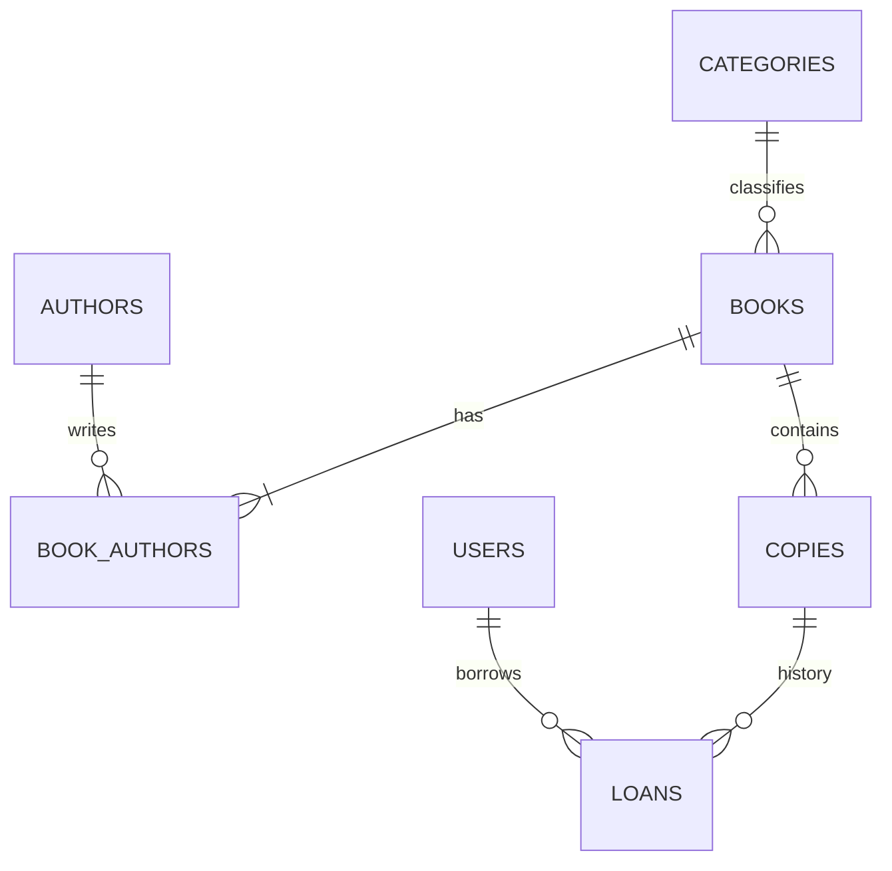

# 📚 LibraTrack — Система обліку бібліотеки / Library Management System

Проєкт курсу **Go with GenAI**, Lesson 9 **Security First**. Продовження завершеного
Lesson 8: Gin REST API, PostgreSQL 16, GORM, нормалізований каталог, Swagger.
Додано bcrypt, JWT, middleware RBAC, керування ролями та облік видач.
База перенесення: Lesson 8, commit `d27b5b7`.

## 🛠️ Швидкий запуск

Потрібні Go **1.27.2** (або автоматичне завантаження toolchain через Go), Docker
Desktop із Compose v2 та Python 3. Порти: API `8080`, PostgreSQL `5439`.

```bash
git clone --branch develop https://github.com/energy6x6/Go-with-GenAI-lessons-9.git
cd Go-with-GenAI-lessons-9
python3 scripts/setup_env.py
docker compose up --wait postgres
go run ./cmd/api
```

API: <http://localhost:8080/api/v1/books>.
Swagger: <http://localhost:8080/swagger/index.html>.
Health: <http://localhost:8080/health>.

Setup генерує два різні паролі PostgreSQL і випадковий JWT-секрет у `.env` із
правами `0600`, не виводячи їх. Наявний `.env` зберігається. Не копіюйте `.env`
Lesson 8: Lesson 9 має власний volume, порт і бази `libratrack9`,
`libratrack9_test`, `libratrack9_migr`. Зміна init-скрипта не переініціалізує volume.

Змінні середовища мають пріоритет над `.env`. `JWT_SECRET` обов'язковий, мінімум
32 байти, без fallback. Решта конфігурації описана в `.env.example`.
API слухає loopback для локальної роботи. Для публічного розгортання потрібні
HTTPS і налаштований reverse proxy; bcrypt/JWT не шифрують HTTP-трафік.

## 📈 Lesson 9 Report — Автентифікація та авторизація

### 1. Проєктування й промпти

[security_design.txt](security_design.txt) містить матрицю всіх маршрутів, DTO,
межі довіри, правила видачі, конфігурацію й список ручної перевірки.
[prompts.txt](prompts.txt) містить специфікації Tasks 2.1/2.2 та промпти аудиту й
тестування, підготовлені за допомогою AI-асистента.

SHA-256 використовується для задач цілісності, bcrypt — для паролів, JWT — для
перевірки підписаної особи. Навчальний HTTP `/hash` і tcpdump-приклад не додаються
до бібліотечного API. Джерело практикуму:
[Hashing workshop](https://killercoda.com/mentorchita/course/crypto/study00).

### 2. Міграції та схема

| Версія | Призначення |
|---|---|
| `000001_init_schema` | Початкова плоска схема Lesson 8 |
| `000002_normalize_books` | Нормалізація, authors/categories/copies/users; збережено |
| `000003_add_auth_fields` | Password hash і унікальність email без урахування регістру |
| `000004_seed_demo_data` | Демонстраційні дані Lesson 8 |
| `000005_loans` | Видачі, зовнішні ключі, обмеження та індекси |

Номер seed змінено **лише в новому Lesson 9**, щоб зберегти вимагану домашнім
завданням назву `000003_add_auth_fields`. Потрібна нова база; цей ланцюжок не
можна застосовувати поверх БД Lesson 8 із уже виконаною версією 3.
`role` вже створено міграцією 2: auth-міграція зберігає поле й його CHECK,
а її rollback не видаляє успадковану роль. Демонстраційний читач не має придатного
пароля для входу; нові користувачі реєструються через API. AutoMigrate не використовується.



Видача триває 14 днів; оформлення та повернення — операції персоналу.
Транзакції, блокування рядків і partial unique index гарантують одну активну
видачу на примірник. Історія видач захищена FK `ON DELETE RESTRICT`.
Штрафи не входять до цієї реалізації домашнього завдання.

### 3. Матриця доступу

У таблиці шляхи мають префікс `/api/v1`.

| Рівень | Маршрути |
|---|---|
| Public | `POST /auth/register`, `POST /auth/login`; усі GET каталогу: books/authors/categories/copies/availability |
| Authenticated | `GET /me/loans`, `PUT /me/profile` |
| librarian / admin | `POST /books`, `PUT /books/:id`, `DELETE /books/:id`, створення authors/categories/copies, `POST /loans`, `POST /loans/:id/return` |
| admin | `GET /users`, `PUT /users/:id/role` |

`/health` і `/swagger/*` публічні. Реєстрація маршрутів лишається в успадкованому
`internal/app.NewRouter`, який викликає `cmd/api/main.go`. `staff` і `admin` —
сусідні вкладені групи `protected`: спочатку AuthMiddleware, потім RequireRole.
401 означає відсутню/невалідну особу; 403 — роль без потрібного дозволу.
Відмови зупиняють Gin handler chain через `AbortWithStatusJSON`.

Реєстрація завжди створює `reader`. Для початкового адміністратора спочатку
зареєструйте обліковий запис через API, потім локально виконайте:

```bash
go run ./cmd/set-role -email admin9@example.com -role admin
```

Команда потребує локальних DB credentials і не є HTTP endpoint. Після зміни ролі
потрібно увійти знову. Далі адміністратор може змінювати ролі через API.

### 4. Захист даних

- bcrypt `DefaultCost=10`; пароль має мінімум 12 символів і максимум 72 UTF-8 байти.
- `RegisterRequest` / `UpdateProfileRequest` не містять внутрішніх полів; зайві JSON-поля відхиляються.
- `PasswordHash` має `json:"-"`; список користувачів не вибирає hash із БД.
- Невідомий email і неправильний пароль: однаковий 401 з `invalid credentials`.
- Для відсутнього облікового запису виконується dummy bcrypt comparison.
- HS256 JWT містить `user_id`, `role`, `exp` на 24 години та `iat`; перевірка вимагає `exp` і дозволяє лише HS256.
- Перевіряються поточний користувач і роль із БД: старий токен після зміни ролі не приймається.
- `/me/loans` використовує ID із перевіреного токена; довільний `user_id` filter не дозволено.
- Логи пропускають bodies/headers/query strings; SQL-параметри приховані; auth-відповіді мають `Cache-Control: no-store`.
- Auth endpoints обмежено до 20 запитів/хвилину на IP; довільні forwarded headers не вважаються довіреними.
- CORS дозволяє лише `ALLOWED_ORIGIN`, з `Authorization` у preflight.

### 5. Аудит та перевірки

[security_audit.md](security_audit.md) містить знахідки, severity, точні рядки,
triage та перевірки. Приклади тестів LMS адаптовано: тести викликають справжній
router, handlers, middleware, bcrypt/JWT та PostgreSQL, без mock-auth.

```bash
go build ./...
go vet ./...
go test -v ./...
go test -race -count=1 -coverpkg=./... -covermode=atomic -coverprofile=cover.out -json ./... > test-results.jsonl
python3 scripts/test_summary.py test-results.jsonl
go tool cover -func=cover.out
go run golang.org/x/vuln/cmd/govulncheck@v1.9.0 ./...
```

Тести використовують лише БД із суфіксом `_test`, окрему випадкову схему на тест
і перевіряють rollback/up, конкурентні операції та успадковану оптимізацію N+1.
Пропущені тести через відсутню БД не є повною перевіркою; CI відхиляє skips.
Фактичні результати поточної перевірки збережено в `evidence/verification.txt`.
Workflow: `.github/workflows/security-check.yml`.

Swagger оновлюється командою:

```bash
go run github.com/swaggo/swag/cmd/swag@v1.16.4 init -g cmd/api/main.go
gofmt -w docs
```

### 6. Докази для здачі

Для здачі додайте до LMS документ зі скриншотами запуску й перевірок API та
посилання на репозиторій із відповідною гілкою. Робоча гілка — `develop`.

---

# 📚 LibraTrack — Library Management System

**Go with GenAI, Lesson 9: Security First.** Extends completed Lesson 8
(commit `d27b5b7`) with bcrypt, 24-hour HS256 JWTs, middleware RBAC, user roles,
profile updates and transactional loans. Retains PostgreSQL, normalized catalog,
GORM repositories, Swagger and the N+1 fix.

## 🛠️ Quick Start

Use Go **1.27.2**, Docker Desktop/Compose v2 and Python 3. Clone `develop`, run
`python3 scripts/setup_env.py`, `docker compose up --wait postgres`, then
`go run ./cmd/api`. Swagger: <http://localhost:8080/swagger/index.html>.
API binds loopback; PostgreSQL uses localhost port **5439** and a separate volume.
Setup creates distinct random database passwords and a JWT secret in ignored
`.env` (0600). Existing environment values override `.env`.

## 📈 Lesson 9 Report

1. **Design and prompts:** see `security_design.txt` and `prompts.txt`. Public
   registration assigns reader only. Authenticated readers see their own loans;
   librarians/admins manage catalog and loans; admins alone manage users/roles.
2. **Migrations:** `000001_init_schema` → `000002_normalize_books` →
   `000003_add_auth_fields` → `000004_seed_demo_data` → `000005_loans`.
   The seed was renumbered in this new repository to match the homework's auth
   filename. Use a fresh Lesson 9 database, never the existing Lesson 8 database.
   The inherited role column is preserved during auth rollback.
3. **Authentication:** bcrypt DefaultCost 10; password length 12+ characters and
   at most 72 UTF-8 bytes. Generic login failures, dummy comparison, DTO allow-lists,
   hidden password hashes and parameterized queries. JWT_SECRET has no fallback;
   verification pins HS256, requires expiration and checks current DB identity/role.
4. **Authorization:** nested route groups execute authentication before RBAC.
   Missing/invalid identity returns 401, disallowed role returns 403. All failures
   abort the chain. The inherited router remains in internal/app, called by main.
   Bootstrap a registered admin locally with `go run ./cmd/set-role -email
   admin9@example.com -role admin`, then log in again. Subsequent changes use the
   admin endpoint. Loans last 14 days; staff issue/return copies; no fines.
5. **Review and tests:** `security_audit.md` records triaged findings and known
   limitations. Adapted LMS scenarios exercise the real application/PostgreSQL,
   including role boundaries, bad tokens, ownership, leakage, concurrent writes
   and migration round trips. Use the validation commands above. Actual results
   are in `evidence/verification.txt`; CI rejects failed or skipped tests.
6. **Evidence:** submit a document with screenshots of the running application
   and API checks, together with the repository and branch link, through the LMS.
